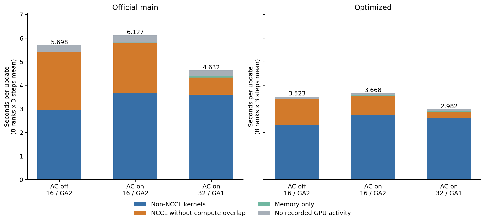

# 激活重算为什么能带来更高吞吐：Profiling归因

## 结论

这次收益来自重算允许使用更大的microbatch，从而把GA2改为GA1，减少每次参数更新的FSDP通信轮次和暴露出来的通信/同步时间。重算并没有减少计算成本。固定mbs16、GA2时，开启重算的控制组反而更慢。

优化版的直接证据：AllGather从222次降至111次，ReduceScatter从366次降至183次；DistMuon优化器的106次All-to-All保持不变。原版的对应计数与耗时见下表。

## 时间线分解

每组8个rank、每rank第31–33次更新，共24个观测的均值。以下是采集窗口的解释性数据，不替代[此前无Profiler的200步吞吐结果](../report.md)。

| 配置 | 窗口耗时 秒 | 非NCCL计算活动 秒 | 未被计算覆盖的NCCL 秒 | 仅内存操作 秒 | 无GPU活动 秒 |
| --- | --- | --- | --- | --- | --- |
| 原版 不重算16 GA2 | 5.6980 | 2.9557 | 2.4517 | 0.0125 | 0.2781 |
| 原版 重算16 GA2 | 6.1274 | 3.6697 | 2.1120 | 0.0281 | 0.3176 |
| 原版 重算32 GA1 | 4.6324 | 3.5974 | 0.7320 | 0.0539 | 0.2491 |
| 优化版 不重算16 GA2 | 3.5226 | 2.3189 | 1.1024 | 0.0109 | 0.0904 |
| 优化版 重算16 GA2 | 3.6677 | 2.7383 | 0.8166 | 0.0108 | 0.1019 |
| 优化版 重算32 GA1 | 2.9823 | 2.6120 | 0.2633 | 0.0177 | 0.0893 |

先对各类GPU事件取时间区间并集，再计算重叠。四个互斥区间之和等于CPU更新标记的持续时间。这里的“计算活动”表示非NCCL kernel执行区间，不代表硬件算术单元利用率；“未被计算覆盖的NCCL”包含传输、同步及等待其他rank，不能全部解释成纯网络传输时间。无GPU活动区间也不能全部归因于CPU调度。

## 通信次数与逻辑消息量

| 配置 | AllGather | ReduceScatter | AllReduce | All-to-All | AllGather输出 GiB/rank | ReduceScatter输入 GiB/rank |
| --- | --- | --- | --- | --- | --- | --- |
| 原版 不重算16 GA2 | 292 | 292 | 6 | 106 | 57.256 | 47.504 |
| 原版 重算16 GA2 | 292 | 292 | 6 | 106 | 57.256 | 47.504 |
| 原版 重算32 GA1 | 146 | 146 | 6 | 106 | 28.628 | 23.752 |
| 优化版 不重算16 GA2 | 222 | 366 | 6 | 106 | 30.408 | 47.504 |
| 优化版 重算16 GA2 | 222 | 366 | 6 | 106 | 30.408 | 47.504 |
| 优化版 重算32 GA1 | 111 | 183 | 6 | 106 | 15.204 | 23.752 |

次数为trace中NCCL kernel事件数，24个观测逐项一致。逻辑消息量来自Kineto的Collective name、In/Out msg nelems和dtype元数据；它不是实际链路传输字节数。优化版重算32有2个观测各缺1个AllGather消息大小，优化版不重算16有2个观测各缺1个ReduceScatter消息大小。消息量取对应元数据完整观测的中位数（至少22/24）；不补造缺失值。次数和时间仍使用全部24个观测。SendRecv kernel按元数据识别为all_to_allv，不能混算为FSDP收集或归约。

## 控制组把因果链拆开

| 原版 配置变化 | 计算活动变化 秒 | 暴露NCCL变化 秒 | 更新耗时变化 秒 |
| --- | --- | --- | --- |
| 固定16 GA2，关闭→开启重算 | +0.7140 | -0.3397 | +0.4294 |
| 固定开启重算，16 GA2→32 GA1 | -0.0722 | -1.3801 | -1.4950 |
| 最终端点，不重算16→重算32 | +0.6418 | -1.7198 | -1.0656 |

| 优化版 配置变化 | 计算活动变化 秒 | 暴露NCCL变化 秒 | 更新耗时变化 秒 |
| --- | --- | --- | --- |
| 固定16 GA2，关闭→开启重算 | +0.4194 | -0.2857 | +0.1451 |
| 固定开启重算，16 GA2→32 GA1 | -0.1263 | -0.5533 | -0.6853 |
| 最终端点，不重算16→重算32 | +0.2931 | -0.8391 | -0.5402 |

负数表示耗时减少。固定16 GA2的控制组保持了通信轮次，显示重算额外计算的净成本；固定开启重算的比较同时改变microbatch与累积轮次，显示完整执行配置的收益，不能把计算活动的缩短全部单独归因于GEMM效率。

## 不开启Profiler的独立复核

新增的重算16控制组另用原始计时harness运行80次更新，完全不开启Profiler。每一步取8个rank最大时间，统计第31–80次；原始日志和配置一并保存。

| 代码 | 原不重算16 GA2均值 秒 | 新增重算16 GA2均值 秒 | 原重算32 GA1均值 秒 |
| --- | --- | --- | --- |
| main | 5.5869 | 5.9905 | 4.5281 |
| opt | 3.4538 | 3.6195 | 2.9058 |

本表统一使用31–80均值；原端点来自此前两轮的平均，新增控制组为本次单次80步运行。这些均为无Profiler测量，未与采集窗口耗时混合。

| 采集运行 | 采集前11–29均值 秒 | 采集后37–60均值 秒 | 采集31–33最大rank均值 秒 |
| --- | --- | --- | --- |
| 原版 不重算16 GA2 | 5.5821 | 5.6082 | 5.6982 |
| 原版 重算16 GA2 | 5.9978 | 6.0110 | 6.1275 |
| 原版 重算32 GA1 | 4.5232 | 4.5419 | 4.6324 |
| 优化版 不重算16 GA2 | 3.4543 | 3.4684 | 3.5227 |
| 优化版 重算16 GA2 | 3.6101 | 3.6799 | 3.6679 |
| 优化版 重算32 GA1 | 2.8894 | 2.9178 | 2.9824 |

导出trace会扰动相邻步骤，因此采集后的比较排除第34–36次。保留所有慢步，不为获得好看的均值删除异常记录。采集有额外开销，最终吞吐引用无Profiler结果；阶段分解用于解释执行路径。

## 采集与复核方法

同一台8卡RTX PRO 5000，main be969b8、优化版71a41bc；沿用上一轮的模型、数据、teacher模式、global batch 256、seed、学习率、NCCL、NUMA及expandable_segments。六组各60次更新，第30次Profiler预热，第31–33次记录CPU+CUDA，全部8个rank保存trace。record_shapes、with_stack、profile_memory均关闭；没有新增每个阶段的CUDA同步。

通过AST包装既有计时入口，增加microbatch、prepare/teacher/prologue、forward、backward、after_backward/reshard、optimizer标记，不改训练计算。Kineto同时输出CPU和GPU注释，统计只用CPU user_annotation作为更新边界，避免重复计数。

原始执行逻辑与trace一致：每个microbatch都backward；优化版每次backward后调用after_backward，排空在途ReduceScatter并重新分片。第二个microbatch再次收集参数。PR2改善了microbatch内部调度，并未让两份microbatch共享一次梯度归约或跨microbatch保留完整参数。

完整原始trace保存在原机器 `/root/experiments/lingbot-profile-20261108` 和本地归档。`analysis.json`保存每rank每步事件统计，`attribution.json`保存表格与差值，`analyze.py`是原始trace分析入口。

## 结论边界

证据支持本硬件、本代码与这两套配置下，减少暴露的FSDP通信/同步是净提速的主要来源。时间线分解是观测到的执行区间，并非对每个机制独立干预后的唯一因果百分比。没有测量实际链路带宽、Tensor Core利用率或最终模型效果，也不能推广为“单独打开重算就会加速”。
