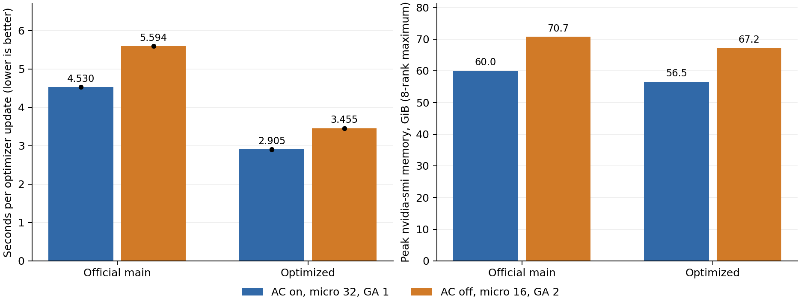

# LingBot VLA 激活重算与微批量四组对照实验报告

2026-11-08 18:59 · 单机8卡 RTX PRO 5000 · global batch 256 · 两轮镜像重复

## 结论

main：重算32与不重算16的完整更新均值分别为 4.5305 秒和 5.5940 秒。重算32的吞吐提高 23.47%。

优化版：重算32与不重算16的完整更新均值分别为 2.9053 秒和 3.4547 秒。重算32的吞吐提高 18.91%。

以上比较使用同一分配器设置、相同global batch及完整参数更新的端到端时间。短程loss仅检查训练健康，未进行下游成功率或完整收敛评测。

## 实验配置与方法

方案A：激活重算开启、micro batch 32、梯度累积1。方案B：激活重算关闭、micro batch 16、梯度累积2。两者均为8卡，每次更新处理256个样本，使用相同初始权重、学习率1e-4与50000步学习率调度。每次实际训练200次更新，不保存checkpoint。

速度差是两种完整执行配方的净效果，包含重算、micro batch、梯度累积、编译和FSDP调度的交互。

main为be969b8；优化版为Qihan报告使用的71a41bc，开启ViT拆分与位置缓存、离线teacher cache、RMSNorm编译、QKV与SwiGLU融合、FSDP反向参数保留、预取深度4及ReduceScatter在途深度4。额外bf16 attention与fsdp_align_root关闭。main使用在线teacher；同一代码内的两个方案保持teacher模式一致。

四组统一设置 `PYTORCH_CUDA_ALLOC_CONF=expandable_segments:True`。运行顺序为main B、main A、优化B、优化A、优化A、优化B、main A、main B。数据为RoboTwin clean50 PNG，8个worker，prefetch factor 2，NCCL_MIN_CTAS=8、NCCL_NTHREADS=128、NCCL_P2P_READ_ENABLE=1，每个rank按GPU绑定NUMA。

计时从取数据前开始，覆盖所有累积micro-batch、teacher、前向、反向、通信、optimizer和日志，取8个rank的最大耗时。主窗口为第31–200次；主均值包含所有卡顿。每组两次运行等权合并；表中的中位数是两次运行中位数的平均。吞吐=256÷主均值。

## Qihan报告复现

使用原样benchmark各运行80步，先验证第31–80步的中位数。两组均完整完成，复现偏差小于1%。

| 版本 | 报告中位数 秒 | 本次中位数 秒 | 偏差 |
| --- | --- | --- | --- |
| repro_main_ac32 | 4.527 | 4.5276 | +0.014% |
| repro_opt_ac32 | 2.886 | 2.9044 | +0.639% |

## 四组性能与显存

| 配置 | 完整更新均值 秒 | 中位数 秒 | samples/s | nvidia-smi峰值 MiB | torch分配峰值 GiB |
| --- | --- | --- | --- | --- | --- |
| main 重算32 GA1 | 4.5305 | 4.5302 | 56.51 | 61,481 | 53.71 |
| main 不重算16 GA2 | 5.5940 | 5.5827 | 45.76 | 72,407 | 66.84 |
| 优化版 重算32 GA1 | 2.9053 | 2.9047 | 88.12 | 57,903 | 48.90 |
| 优化版 不重算16 GA2 | 3.4547 | 3.4541 | 74.10 | 68,845 | 63.36 |

黑点为每次运行的均值。nvidia-smi显存按1秒采样，torch分配峰值来自运行时累积峰值，均取两次运行与8个rank的最大值。热降频活动样本数：0。

## 与既有测试方法统一的三套口径

逐文件核对确认Qihan的5个核心benchmark脚本与公开bench-repro@9dc0677逐字节一致，区别在取样区间与统计量。本次增加观测字段，不改变训练计算或计时边界。

这里的一致指核心计时实现，不代表完整测试流程一致。本次是独立实验，具体区别如下：

| 项目 | 原bench-repro流程 | 本次正式对照 |
| --- | --- | --- |
| 每次运行长度 | 31次更新 | 200次更新 |
| 主统计口径 | 第11–30次均值 | 第31–200次均值 |
| 重复方式 | 原有流程 | 每配置两轮反序测量 |
| 显存分配器 | 默认 | 四组统一expandable_segments |
| 额外观测 | 原始计时字段 | 输入指纹、数据等待、torch显存峰值 |

因此下表11–30均值只是对本次日志按旧窗口重新统计，不能视为完整照搬原测试流程。

| 配置 | 11–30均值 秒 | 31–80中位数 秒 | 31–200均值 秒 |
| --- | --- | --- | --- |
| main 重算32 GA1 | 4.5237 | 4.5282 | 4.5305 |
| main 不重算16 GA2 | 5.5863 | 5.5764 | 5.5940 |
| 优化版 重算32 GA1 | 2.8934 | 2.9057 | 2.9053 |
| 优化版 不重算16 GA2 | 3.4564 | 3.4537 | 3.4547 |

## 显存可运行性与数值检查

默认分配器下main A完成200步，主均值4.5312秒；main B曾通过5步短运行，但正式运行在第5次更新时rank6 backward发生CUDA显存不足，峰值72829 MiB。失败记录完整保留。随后四组统一启用expandable_segments重新测量，主表不混用默认分配器结果。

统一设置后的8次正式运行均完成200次更新，所有记录的loss和梯度范数均为有限值。前3次更新、8个rank的CPU输入张量按完整更新拼接后，两种micro batch方案在每轮均逐项匹配。改变micro batch划分仍会改变模型内部flow-matching随机数的消耗顺序和浮点累加，因此不以短程loss高低判定模型效果。

| 配置 | 31–200总loss均值 | 31–200 VLA loss均值 | 最大梯度范数 | 触发裁剪更新数 | 数值 |
| --- | --- | --- | --- | --- | --- |
| main 重算32 GA1 | 0.10061 | 0.09039 | 0.97153 | 0 | 全部有限 |
| main 不重算16 GA2 | 0.09989 | 0.08967 | 0.88067 | 0 | 全部有限 |
| 优化版 重算32 GA1 | 0.10133 | 0.09109 | 0.80046 | 0 | 全部有限 |
| 优化版 不重算16 GA2 | 0.10085 | 0.09063 | 0.85979 | 0 | 全部有限 |

## 逐次运行与复现

| 运行 | 31–200均值 秒 | 31–200中位数 秒 | P95 秒 | 平均数据等待 毫秒 | 超过中位数1.3倍的更新 |
| --- | --- | --- | --- | --- | --- |
| alloc_main_ac32_r1 | 4.5297 | 4.5294 | 4.5412 | 0.481 | 无 |
| alloc_main_ac32_r2 | 4.5313 | 4.5309 | 4.5405 | 0.479 | 无 |
| alloc_main_noac16_r1 | 5.5929 | 5.5819 | 5.6570 | 0.496 | 无 |
| alloc_main_noac16_r2 | 5.5950 | 5.5834 | 5.6596 | 0.509 | 无 |
| alloc_opt_ac32_r1 | 2.9036 | 2.9037 | 2.9131 | 0.489 | 无 |
| alloc_opt_ac32_r2 | 2.9069 | 2.9057 | 2.9194 | 0.500 | 无 |
| alloc_opt_noac16_r1 | 3.4559 | 3.4555 | 3.4692 | 0.524 | 无 |
| alloc_opt_noac16_r2 | 3.4534 | 3.4527 | 3.4645 | 0.498 | 无 |

完整证据目录：`/root/experiments/lingbot-ac-mbs-20261108`。保留manifest.json、method_audit.json、effective_args.json、每rank逐步JSONL、输入指纹、smi.csv、source.txt、trainer.executed.py、每次启动日志及receipt。源码补丁为optimized-vs-main.patch。重新汇总依次运行summarize_study.py、audit_study.py、aggregate_study.py。

## 本分支的文件与复核入口

- [原始证据目录](evidence/)：完整日志、启动脚本、实际执行的 trainer、有效参数和每次运行的 receipt，保持原始内容。
- [最终汇总](evidence/aggregate.json)、[逐运行统计](evidence/summary_all.json)、[完整性验证](evidence/verification.json)。
- [离线重新统计脚本](scripts/reanalyze.py)：只需 Python 标准库，不使用 GPU，不修改原始日志。
- [文件校验清单](SHA256SUMS)：用于检查导出的原始证据。
- [复现说明](README.md)：环境、代码、数据前提与训练入口。

这里的31–80中位数为两轮分别取中位数后再平均，与单次Qihan复现表的统计对象不同。

四组统一启用expandable_segments后，重算32的31–80中位数分别为main 4.5282秒、优化版2.9057秒，相对Qihan报告4.527秒、2.886秒分别偏离约+0.03%、+0.68%。速度仍可复现到1%以内，显存预留方式和显存峰值则会受分配器影响。
