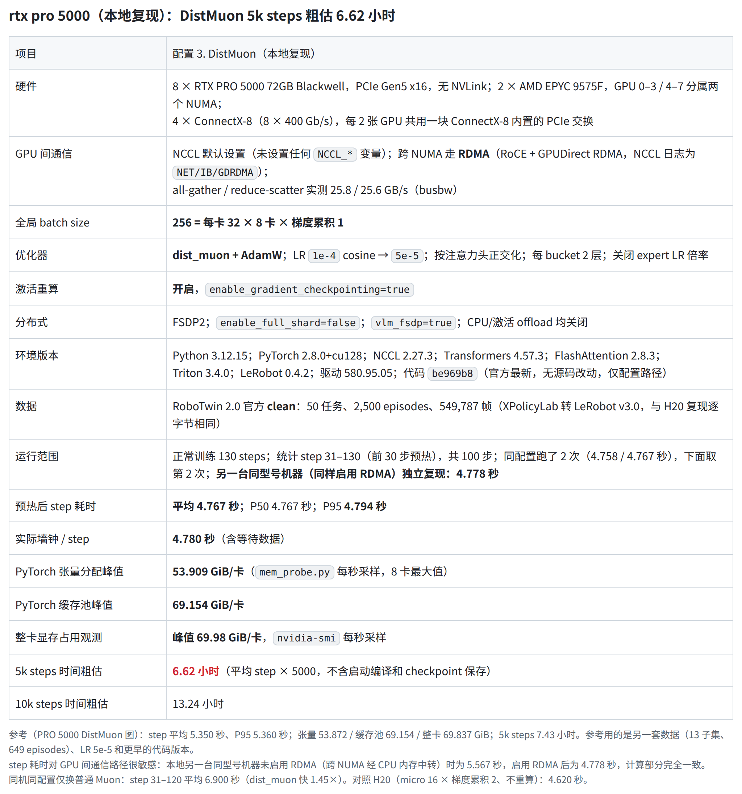

# RTX PRO 5000 单机 8 卡 DistMuon 测速更新

本文汇总 8×RTX PRO 5000 上 Distributed Muon（DistMuon）的最新测速结果、本地两台机器测速不一致的原因，以及可以尝试的提速方法。复现步骤和完整数据见同目录的 [README](README.md)。

## 1. 最新结果



- 官方代码 `be969b8`，官方 `robotwin_dist_muon.yaml`，只改了数据和权重路径；micro 32 × 8 卡 × 梯度累积 1，开激活重算。
- 预热后 step 耗时（step 31–130 平均）**4.767 秒**，P95 4.794 秒。另一台同型号机器独立复现为 **4.778 秒**，两者相差 0.2%。
- 显存峰值 53.9 GiB（张量）/ 69.2 GiB（缓存池），与此前提供的 PRO 5000 测量一致。
- H20 上的结果见 [figures/h20_distmuon_repro.png](figures/h20_distmuon_repro.png)（8×H20，4.620 秒/步）。

## 2. 本地两台机器测速不一致的原因

本地两台机器的硬件完全相同：

| 项目 | 配置 |
|---|---|
| GPU | 8 × RTX PRO 5000 72GB，PCIe Gen5 x16，无 NVLink，驱动 580.95.05 |
| CPU / NUMA | 2 × AMD EPYC 9575F，GPU 0–3 / 4–7 分属两个 NUMA |
| 网卡 | 4 × ConnectX-8（8 × 400 Gb/s），每 2 张 GPU 共用一块 ConnectX-8 内置的 PCIe 交换 |
| 软件 | PyTorch 2.8.0+cu128，NCCL 2.27.3，代码和数据相同 |

但最初一台测得 5.567 秒/步，另一台 4.767 秒/步。对比 timeline 后发现，计算 kernel 和空闲时间基本相同，差距全部在 GPU 间通信上。

原因是**慢的那台在容器里没有启用 RDMA**：

- 这种机器上，同一 NUMA 内的 GPU 直接经 PCIe 通信；跨 NUMA 的 GPU（例如 GPU 3 和 GPU 4）则应该通过 ConnectX-8 网卡用 RDMA 直接传输（RoCE + GPUDirect RDMA），不经过 CPU。
- 容器没有拿到 RDMA 设备时，NCCL 不会报错，而是自动改为经 CPU 内存中转（`SHM`）。训练照常进行，只是跨 NUMA 那一段变慢，整个环形通信都被拖慢。
- 启用 RDMA 后，同一台机器从 5.567 秒降到 4.778 秒，与另一台一致。

容器启用 RDMA 需要加三个参数：

```bash
docker run ... --network=host --device=/dev/infiniband --ulimit memlock=-1 ...
```

- `--device=/dev/infiniband`：把 RDMA 设备映射进容器（RoCE 网卡也在这个目录下）。不加时容器里看不到 RDMA 网卡。
- `--ulimit memlock=-1`：RDMA 需要锁定收发数据的内存，docker 默认的上限太小，会导致 NCCL 放弃 RDMA。
- `--network=host`：使用宿主机网络。RoCE 依赖网口的 IP 地址建立连接，容器独立的网络里看不到这些网口。

GPUDirect RDMA 还需要宿主机加载 `nvidia_peermem` 内核模块（`lsmod | grep nvidia_peermem`）。

## 3. 做过的实验

### 3.1 NCCL 通信带宽

用 [`coll_bw.py`](coll_bw.py) 测 all-gather / reduce-scatter 带宽（nccl-tests 的 busbw 定义，1–2 GB 消息，GB/s）。以下为启用 RDMA 时的结果，两台机器一致：

| NCCL 设置 | all-gather | reduce-scatter |
|---|---:|---:|
| 默认（4 通道 × 512 线程） | 25.8 | 25.6 |
| `NCCL_MIN_CTAS=8` | 26.0 | 26.2 |
| `NCCL_NTHREADS=128` | 23.0 | 17.7 |
| `NCCL_MIN_CTAS=8 NCCL_NTHREADS=128` | 24.9 | 23.5 |
| `NCCL_PROTO=LL` | 约 9 | 约 9 |

启用 RDMA 时，默认设置已经用满链路，调整 NCCL 参数没有收益。

### 3.2 训练速度（DistMuon，step 31–130）

| 跨 NUMA 通信 | NCCL 设置 | step 耗时 |
|---|---|---:|
| RDMA | 默认 | **4.767 / 4.778 秒**（两台机器） |
| 经 CPU 内存中转（未启用 RDMA） | 默认 | 5.567 秒 |
| 经 CPU 内存中转（未启用 RDMA） | `NCCL_MIN_CTAS=8` | 约 5.06 秒 |
| 经 CPU 内存中转（未启用 RDMA） | `NCCL_MIN_CTAS=8 NCCL_NTHREADS=128` | 约 4.66 秒 |

未启用 RDMA 的几行来自单次测量，统计区间与第一行略有不同，仅供参考。可以看到：

- 跨 NUMA 通信走 RDMA 还是经 CPU 内存中转，对 step 耗时影响约 15%。
- 没有 RDMA 时，NCCL 默认的 4 个通道用不满经 CPU 中转的链路；多开通道（`NCCL_MIN_CTAS=8`）可以补回大部分差距。

## 4. 可以尝试的提速方法

以下方法都不改训练代码。**实际效果取决于机器的硬件配置**（网卡型号和数量、GPU 与网卡的 PCIe 拓扑、是否支持 RDMA 等），不一定能达到上面的数字，建议按顺序在目标机器上实测。

1. **先看当前的通信路径。**

   ```bash
   nvidia-smi topo -m          # GPU、网卡和 NUMA 的连接关系
   NCCL_DEBUG=INFO NCCL_DEBUG_SUBSYS=INIT,ENV \
     torchrun --nproc_per_node 8 experiment/single_node_repro/coll_bw.py
   ```

   - 日志里有 `NET/IB : Using ...`，且跨 NUMA 的通道是 `via NET/IB/.../GDRDMA`：已经在用 RDMA。
   - 跨 NUMA 的通道是 `via SHM`：经 CPU 内存中转，没有用上 RDMA。
   - 同时检查环境里是否设置过 `NCCL_*` 变量（`env | grep NCCL`），例如 `NCCL_NTHREADS` 调小会明显降低 reduce-scatter 带宽。

2. **如果机器有支持 RDMA 的网卡，但没有用上**：按第 2 节给容器加上三个参数，并确认宿主机加载了 `nvidia_peermem`。这是最根本的改进。

3. **如果没有 RDMA**：用 `coll_bw.py` 比较以下几组设置的带宽，选带宽最高的一组跑 130 步训练，与默认设置对比 step 耗时：

   ```bash
   torchrun --nproc_per_node 8 experiment/single_node_repro/coll_bw.py
   NCCL_MIN_CTAS=8 torchrun --nproc_per_node 8 experiment/single_node_repro/coll_bw.py
   NCCL_MIN_CTAS=8 NCCL_NTHREADS=128 torchrun --nproc_per_node 8 experiment/single_node_repro/coll_bw.py
   ```

   通道越多，NCCL 占用的 GPU 计算资源也越多，所以最终以训练的 step 耗时为准。已经启用 RDMA 的机器不建议调整这些参数。

更多的训练侧优化（例如通信与计算的重叠）我们还在研究，有结论后再同步。
